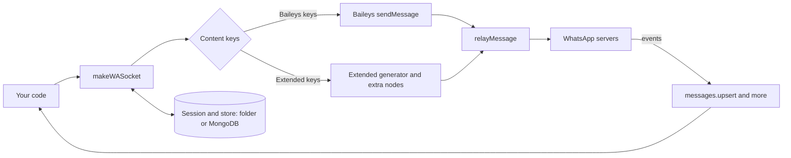

<div align="center">


<br>

<h3>
  <sub>Baileys-compatible WhatsApp Web API for Node.js. Build bots, automations and integrations without rewriting your code.</sub>
</h3>

<p>
  <a href="https://www.npmjs.com/package/@lightning/baileys"></a>
  <a href="https://nodejs.org"></a>
  <a href="./LICENSE"></a>
  
  
</p>

<p>
  <a href="#install"><b>Install</b></a> &nbsp;·&nbsp;
  <a href="#connecting"><b>Connect</b></a> &nbsp;·&nbsp;
  <a href="#sending-messages"><b>Send</b></a> &nbsp;·&nbsp;
  <a href="#mongodb"><b>MongoDB</b></a> &nbsp;·&nbsp;
  <a href="#the-bot-class"><b>Bot</b></a> &nbsp;·&nbsp;
  <a href="#cli"><b>CLI</b></a>
</p>


</div>

## Why `@lightning/baileys`

`@lightning/baileys` (internally **miniwa**) is a Baileys-compatible WhatsApp Web API for Node.js. It keeps the experience you already know (same
`sock.ev`, same `sock.sendMessage`, same `messages.upsert` payloads) and adds what production bots need.

<table>
<tr>
<td width="50%" valign="top">

**Messaging**
- Extended messages through the normal `sendMessage`: native flow buttons, carousels, rich links, ad-reply cards, channel forwards, group mentions, spoilers, payments, status stickers, questions, status mentions, HD pairs and more.
- `sock.relayMessage` recipes for everything that does not fit in `sendMessage`.

</td>
<td width="50%" valign="top">

**Reliability**
- Safer sessions: atomic writes, automatic creds backup and restore, corrupt-file quarantine, export/import and migration between folder and MongoDB.
- Upsert inspector: see exactly what `messages.upsert` delivers, live, in memory, in MongoDB or from a CLI.

</td>
</tr>
<tr>
<td valign="top">

**Storage**
- MongoDB for sessions, message history (used by `getMessage`), chats, contacts, groups and an upsert log.

</td>
<td valign="top">

**Developer experience**
- An optional high-level `Bot` with reconnection supervision and a send queue.
- TypeScript types, a CLI and a test suite.

</td>
</tr>
</table>

> [!WARNING]
> `@lightning/baileys` is an unofficial toolkit and is not affiliated with WhatsApp or Meta. Automating WhatsApp can get numbers
> banned. Use a spare number to test, and do not use it for spam.

## What is it for

`@lightning/baileys` lets your Node.js code act as a **linked device** of a WhatsApp account, the same way WhatsApp Web does. Anything you can do by hand in that
account (read, answer, react, create groups, post statuses) you can do from code, and react to incoming events in real time.

| Use case | What you build with it |
| --- | --- |
| Support and helpdesk | Bots that answer FAQs, route chats to humans and show menus with buttons, lists and carousels. |
| Notifications and alerts | Order updates, payment reminders, monitoring alerts, appointment confirmations. |
| Commerce | Catalog products, orders, payment requests, split payments and invoices inside the chat. |
| Community management | Welcome messages, moderation, `@everyone`, invites, polls and events in groups and communities. |
| Channels and Status | Publish to channels and stories (with stickers, mentions and custom audiences) on a schedule. |
| Integrations | Connect WhatsApp to your CRM, webhooks, databases or an AI assistant. |
| Debugging | Inspect exactly what `messages.upsert` delivers with the upsert inspector and the CLI. |

## How it works

1. **Link.** The socket connects to WhatsApp over a WebSocket as a linked device. You pair it once with a **pairing code** (no QR) and the session is saved.
2. **Persist.** Credentials and Signal keys go to a folder or to MongoDB with atomic writes and automatic backups, so restarts do not log you out.
3. **Listen.** WhatsApp pushes events (`messages.upsert`, `connection.update`, `group-participants.update`, ...). They are the standard Baileys events with the standard payloads.
4. **Send.** `sock.sendMessage(jid, content)` checks the content: plain Baileys keys go straight to Baileys, extended keys (native flow, carousel, status stickers, payments, ...) are built by the extended generator and relayed with the extra nodes WhatsApp needs.
5. **Recover.** The store answers `getMessage` when a recipient cannot decrypt something, and the `Bot` class supervises reconnection and queues sends.



**Which entry point should I use?**

| If you want | Use |
| --- | --- |
| Full control and Baileys-style code | `makeWASocket` + `useSafeAuthState` / `useMongoAuthState` |
| Reconnection, send queue and a friendly `msg` object out of the box | [`Bot`](#the-bot-class) |
| Raw protobuf or custom nodes | [`sock.relayMessage`](#using-sockrelaymessage) |

## Quick start

```js
import makeWASocket, { useSafeAuthState, requestPairing } from "@lightning/baileys"

const auth = await useSafeAuthState("session")
const sock = makeWASocket({ auth, upserts: { print: true } })

if (!sock.authState.creds.registered) {
  console.log("Pairing code:", await requestPairing(sock, "5491112345678"))
}

sock.ev.on("messages.upsert", async ({ messages }) => {
  const m = messages[0]
  if (m.message?.conversation === "hola") {
    await sock.sendMessage(m.key.remoteJid, { text: "hola!" }, { quoted: m })
  }
})
```

## Contents

- [What is it for](#what-is-it-for)
- [How it works](#how-it-works)
- [Quick start](#quick-start)
- [Install](#install)
- [Connecting](#connecting)
  - [Starting a socket](#starting-a-socket)
  - [Linking with a pairing code](#linking-with-a-pairing-code)
  - [Configuring the socket](#configuring-the-socket)
  - [Saving and restoring sessions](#saving-and-restoring-sessions)
  - [Handling events](#handling-events)
  - [Implementing `getMessage`](#implementing-getmessage)
- [Sending messages](#sending-messages)
  - [Basic messages (same as Baileys)](#basic-messages-same-as-baileys)
  - [Media](#media)
  - [Albums, HD and motion photos](#albums-hd-and-motion-photos)
  - [Buttons, lists and native flow](#buttons-lists-and-native-flow)
  - [Carousel](#carousel)
  - [Replying to interactive messages](#replying-to-interactive-messages)
  - [Links and cards](#links-and-cards)
  - [Mentions, forwards, spoilers and events](#mentions-forwards-spoilers-and-events)
  - [Polls](#polls)
  - [Payments and orders](#payments-and-orders)
  - [Contact sharing and privacy](#contact-sharing-and-privacy)
  - [Groups, communities and channels](#groups-communities-and-channels)
  - [Questions and comments](#questions-and-comments)
  - [Status (stories)](#status-stories)
  - [Sticker packs, songs and products](#sticker-packs-songs-and-products)
  - [Modifying messages](#modifying-messages)
- [Using `sock.relayMessage`](#using-sockrelaymessage)
- [Protocol support matrix](#protocol-support-matrix)
- [MongoDB](#mongodb)
- [Sessions in depth](#sessions-in-depth)
- [Upsert inspector](#upsert-inspector)
- [The Bot class](#the-bot-class)
- [API facades](#api-facades)
- [CLI](#cli)
- [TypeScript](#typescript)
- [Running on Termux](#running-on-termux)
- [Testing](#testing)
- [Project layout](#project-layout)
- [Security notes](#security-notes)
- [Credits and license](#credits-and-license)

<div align="center"></div>

## Install

```bash
npm install @lightning/baileys
npm install mongodb   # only for MongoDB sessions/store
npm install sharp     # optional: thumbnails, sticker packs and image processing
```

Node.js 20 or newer. The package is ESM. Every export of the vendored Baileys engine (`src/vendor/baileys`, no separate Baileys install needed) is re-exported, so
`import { DisconnectReason, jidDecode, proto } from "@lightning/baileys"` works.

## Connecting

### Starting a socket

Write it exactly as you would with Baileys. Only the import changes.

```js
import makeWASocket, {
  useSafeAuthState,            // crash-safe useMultiFileAuthState (same folder layout)
  fetchLatestBaileysVersion,
  Browsers,
  parseDisconnect,
  Backoff
} from "@lightning/baileys"
import pino from "pino"

const logger = pino({ level: "silent" })
const backoff = new Backoff({ min: 1000, max: 30_000 })

async function connect() {
  const auth = await useSafeAuthState("session", { logger })
  const { version } = await fetchLatestBaileysVersion()

  const sock = makeWASocket({
    version,
    auth,                                   // creds.update is wired for you
    logger,
    browser: Browsers.ubuntu("Chrome"),
    upserts: { print: true }                // log every messages.upsert
  })

  sock.ev.on("connection.update", async ({ connection, lastDisconnect }) => {
    if (connection === "open") { backoff.reset(); console.log("Connected as", sock.user.id) }
    if (connection === "close") {
      const d = parseDisconnect(lastDisconnect)     // { code, reason, reconnect, fatal, loggedOut, immediate }
      if (d.loggedOut) return auth.clear()
      if (d.reconnect) setTimeout(connect, d.immediate ? 0 : backoff.next())
    }
  })

  return sock
}

const sock = await connect()
```

`makeWASocket` is the socket factory (alias of `makeMiniwaSocket`, also the default export). It returns a normal
Baileys socket plus `sock.upserts`, `sock.store` and `sock.miniwa` (the [API facades](#api-facades)). When `auth` is the
result of `useSafeAuthState` / `useMongoAuthState`, credentials are saved automatically. You can also pass a raw Baileys auth
object (`{ creds, keys }`) and wire `creds.update` yourself.

### Linking with a pairing code

There is no QR flow. Request a code for the number you want to link (country code, digits only):

```js
import makeWASocket, { requestPairing } from "@lightning/baileys"

const sock = makeWASocket({ auth })
if (!sock.authState.creds.registered) {
  const code = await requestPairing(sock, "5491112345678")   // optionally a custom 8-char code as 3rd argument
  console.log("Enter this code in WhatsApp > Linked devices:", code)
}
```

`requestPairing` waits for the right moment of the connection. It is the same as calling `sock.requestPairingCode()` from
the first `connection.update`.

### Configuring the socket

Everything Baileys accepts goes into `makeWASocket({...})`. `@lightning/baileys` adds:

| Option | Description |
| --- | --- |
| `auth` | Result of `useSafeAuthState` / `useMongoAuthState` / `useMemoryAuthState`, or a raw Baileys auth object. Required. |
| `store` | A `MongoStore` or `MessageStore`. Provides `getMessage`, group metadata cache and persistence. |
| `upserts` | `{ size, print }` or an `UpsertRecorder`. See [Upsert inspector](#upsert-inspector). |
| `extend` | `false` to skip the extended message layer (plain Baileys `sendMessage`). Default `true`. |
| `cacheKeys` | `false` to skip `makeCacheableSignalKeyStore`. Default `true`. |

Defaults that differ from a bare Baileys socket: no QR printing, `markOnlineOnConnect: false`, `syncFullHistory: false`,
25 s keep-alive, `maxMsgRetryCount: 5`, and `getMessage` / `cachedGroupMetadata` backed by the store. Anything you pass overrides them.

### Saving and restoring sessions

```js
const auth = await useSafeAuthState("session")                         // folder, same layout as Baileys
const auth = await useMongoAuthState({ uri, dbName: "whatsapp", session: "bot-1" })   // MongoDB
const auth = await useMemoryAuthState()                                // tests only
```

See [Sessions in depth](#sessions-in-depth) for backups, export/import and migration.

### Handling events

Standard Baileys events, standard payloads:

```js
sock.ev.on("messages.upsert", async ({ messages, type }) => {
  if (type !== "notify") return
  for (const m of messages) {
    if (m.key.fromMe) continue
    const text = m.message?.conversation || m.message?.extendedTextMessage?.text
    if (text === "hola") await sock.sendMessage(m.key.remoteJid, { text: "hola!" }, { quoted: m })
  }
})

// or process batches of events at once
sock.ev.process(async events => {
  if (events["connection.update"]) { /* ... */ }
  if (events["messages.reaction"]) { /* ... */ }
  if (events["group-participants.update"]) { /* ... */ }
})
```

All the usual events exist: `connection.update`, `creds.update`, `messages.upsert`, `messages.update`, `messages.delete`,
`messages.reaction`, `message-receipt.update`, `presence.update`, `chats.upsert`, `chats.update`, `contacts.upsert`,
`contacts.update`, `groups.upsert`, `groups.update`, `group-participants.update`, `call`, `newsletter.*` and more.

### Implementing `getMessage`

WhatsApp asks for the original message when a recipient cannot decrypt it. `makeWASocket` already provides `getMessage`
from the store you pass. With `MongoStore` the messages survive restarts:

```js
import makeWASocket, { MongoStore, useMongoAuthState, connectMongo } from "@lightning/baileys"

const { db } = await connectMongo({ uri: process.env.MONGODB_URI, dbName: "whatsapp" })
const auth  = await useMongoAuthState({ db, session: "bot-1" })
const store = await MongoStore.create({ db, session: "bot-1" })

const sock = makeWASocket({ auth, store })   // store.bind(sock.ev) is done for you
```

To use your own storage, pass `getMessage: async key => proto.Message | undefined` and it replaces the default.

## Sending messages

`sock.sendMessage(jid, content, options)` works exactly like Baileys. Content that only uses Baileys keys goes straight to
Baileys. Content with an extended key (see `EXTENDED_KEYS`) is built by the extended generator and relayed with the extra
nodes it needs. The same content works from `bot.send(jid, content)` and `msg.send(content)`.

> [!NOTE]
> Interactive and extended messages are not an official, stable WhatsApp API. How they render depends on the WhatsApp
> client and version, and some need protocol definitions your Baileys build may not have: see the
> [support matrix](#protocol-support-matrix). Test with a spare number before using them widely.

JIDs: `5491112345678@s.whatsapp.net` (user), `120363...@g.us` (group), `120363...@newsletter` (channel), `status@broadcast` (status).

### Basic messages (same as Baileys)

```js
await sock.sendMessage(jid, { text: "hello" })
await sock.sendMessage(jid, { text: "hello" }, { quoted: m })                     // reply
await sock.sendMessage(jid, { text: "@5491112345678 hi", mentions: ["5491112345678@s.whatsapp.net"] })
await sock.sendMessage(jid, { react: { text: "💖", key: m.key } })               // reaction ("" removes it)
await sock.sendMessage(jid, { forward: m })                                       // forward (add force: true to skip checks)
await sock.sendMessage(jid, { location: { degreesLatitude: -34.6, degreesLongitude: -58.4, name: "Obelisco" } })
await sock.sendMessage(jid, { contacts: { displayName: "Ana", contacts: [{ vcard }] } })
await sock.sendMessage(jid, { disappearingMessagesInChat: 86400 })                // 0 = off, true = default
```

Contact vCard:

```js
const vcard = "BEGIN:VCARD\nVERSION:3.0\nFN:Ana\nTEL;type=CELL;waid=51910108***:+51910108***\nEND:VCARD"
```

### Media

```js
await sock.sendMessage(jid, { image: { url: "https://example.com/a.jpg" }, caption: "hi" })
await sock.sendMessage(jid, { image: buffer, caption: "from a Buffer" })
await sock.sendMessage(jid, { video: { url }, caption: "clip", gifPlayback: true })
await sock.sendMessage(jid, { video: { url }, ptv: true })                        // round video note
await sock.sendMessage(jid, { audio: { url }, mimetype: "audio/mp4" })
await sock.sendMessage(jid, { audio: { url }, ptt: true, mimetype: "audio/ogg; codecs=opus" })   // voice note
await sock.sendMessage(jid, { sticker: webpBuffer })
await sock.sendMessage(jid, { document: { url }, fileName: "report.pdf", mimetype: "application/pdf" })
await sock.sendMessage(jid, { image: { url }, caption: "view once", viewOnce: true })
```

Sources can be `{ url }`, a `Buffer`, or `{ stream }`. Install `sharp` for faster thumbnails.

### Albums, HD and motion photos

```js
// Album: a header message plus every item, associated to it (2 or more items)
await sock.sendMessage(jid, {
  album: [
    { image: { url: "https://example.com/1.jpg" }, caption: "one" },
    { video: { url: "https://example.com/2.mp4" }, caption: "two" }
  ]
}, { delayMs: 1500 })     // pause between items (default 1500)

// SD + HD pair
await sock.sendMessage(jid, { image: { url }, caption: "HD", hd: true })
await sock.sendMessage(jid, { video: { url }, caption: "HD", hd: true })
await sock.sendMessage(jid, { image: { url: sdUrl }, hd: { url: hdUrl } })   // different HD source

// Motion photo: still + video
await sock.sendMessage(jid, { image: { url: still }, video: { url: clip }, caption: "motion" })
```

### Buttons, lists and native flow

```js
// Native flow (recommended): quick reply, url, copy, call, list
await sock.sendMessage(jid, {
  title: "Menu", text: "Pick one", footer: "@lightning/baileys",
  nativeFlow: [
    { text: "Hola", id: "hola" },                                  // quick reply
    { text: "Website", url: "https://example.com" },                // url button (useWebview: true to open in-app)
    { text: "Copy code", copy: "ABC123" },                          // copy button
    { text: "Call us", call: "+5491112345678" }                     // call button
  ]
}, { quoted: m })

// Native flow with media header
await sock.sendMessage(jid, {
  image: { url: "https://example.com/banner.jpg" },
  text: "Look at this", footer: "@lightning/baileys",
  nativeFlow: [{ text: "Open", url: "https://example.com" }]
})

// Native flow with a list (single_select)
await sock.sendMessage(jid, {
  text: "Choose a fruit", footer: "@lightning/baileys",
  nativeFlow: [{
    text: "Open list",
    sections: [{ title: "Fruit", rows: [{ title: "Apple", description: "Red", id: "apple" }, { title: "Pear", id: "pear" }] }]
  }]
})

// Offer / coupon and bottom sheet options
await sock.sendMessage(jid, {
  text: "Weekend deal", footer: "@lightning/baileys",
  offerText: "20% off", offerUrl: "https://example.com/deal", offerCode: "SAVE20", offerExpiration: Date.now() + 86_400_000,
  nativeFlow: [{ text: "Details", url: "https://example.com/deal" }]
})

// Classic buttons (buttonsMessage)
await sock.sendMessage(jid, {
  text: "Choose", footer: "@lightning/baileys",
  buttons: [{ id: "yes", text: "Yes" }, { id: "no", text: "No" }]
})

// List message
await sock.sendMessage(jid, {
  text: "Pick one", title: "Menu", footer: "@lightning/baileys", buttonText: "Open",
  sections: [{ title: "Section", rows: [{ title: "Row 1", rowId: "r1", description: "first" }] }]
})

// Template buttons
await sock.sendMessage(jid, {
  text: "Template", footer: "@lightning/baileys",
  templateButtons: [{ id: "a", text: "Reply" }, { url: "https://example.com", text: "Open" }, { call: "+5491112345678", text: "Call" }]
})
```

The fluent builders produce the same content:

```js
import { NativeFlow } from "@lightning/baileys"
await sock.sendMessage(jid, new NativeFlow().title("Menu").text("Pick").footer("@lightning/baileys").reply("Hola", "hola").url("Web", "https://example.com").build())
```

Native flow allows up to 10 quick-reply buttons, or up to 3 buttons of other kinds. Helpers: `NATIVE_FLOW_NAMES`, `checkNativeFlowButtons(buttons)`.

### Carousel

```js
await sock.sendMessage(jid, {
  text: "Our cards", footer: "@lightning/baileys",
  cards: [
    { image: { url: "https://example.com/a.jpg" }, title: "One", caption: "First card", footer: "card footer",
      nativeFlow: [{ text: "Pick", id: "one" }, { text: "Open", url: "https://example.com/1" }] },
    { image: { url: "https://example.com/b.jpg" }, title: "Two", caption: "Second card",
      nativeFlow: [{ text: "Pick", id: "two" }] }
  ]
})
```

Cards accept `image` or `video`. The `Carousel` builder produces the same structure.

### Replying to interactive messages

Incoming button, list and flow replies arrive with the id in `msg.text` (Bot) or in the message content. You can also **send** replies, which is useful for testing and automation:

```js
await sock.sendMessage(jid, { buttonReply: { id: "yes", displayText: "Yes" }, type: "plain" })          // legacy buttons
await sock.sendMessage(jid, { buttonReply: { id: "a", displayText: "Reply", index: 0 }, type: "template" })   // template buttons
await sock.sendMessage(jid, { listReply: { id: "apple", title: "Apple", description: "Red" } })
await sock.sendMessage(jid, { flowReply: { name: "quick_reply", text: "Hola", paramsJson: JSON.stringify({ id: "hola" }) } })
```

### Links and cards

```js
// Rich link preview with your own title, description and image
await sock.sendMessage(jid, {
  richLink: { url: "https://example.com", text: "Check this", title: "Example", description: "A rich preview", image: { url: "https://example.com/og.jpg" }, large: true }
})

// "Ad reply" card: title + body + thumbnail (Buffer) that opens a URL
await sock.sendMessage(jid, {
  text: "Check it out",
  externalAdReply: { title: "My site", body: "Open it", thumbnail: buffer, url: "https://example.com", largeThumbnail: true }
})
// externalAdReply also works on media captions and audio

// Link preview style for a status
await sock.sendMessage("status@broadcast", { text: "https://example.com", statusLinkPreview: { style: 1 } }, { statusJidList })
```

`socialPreview` exists for decoding the previews Meta sends; clients do not draw it from messages you send.

### Mentions, forwards, spoilers and events

```js
// @everyone
await sock.sendMessage(groupJid, { text: "Attention everyone!", mentionAll: true })

// Mention other groups
await sock.sendMessage(groupJid, { text: "see", groupMentions: [{ groupJid: "120363111111111111@g.us", groupSubject: "Other group" }] })

// Show as forwarded from a channel
await sock.sendMessage(jid, {
  text: "News!",
  forwardedNewsletter: { newsletterJid: "120363000000000000@newsletter", newsletterName: "My channel", serverMessageId: 7 }
})

// Spoiler (works on text and media)
await sock.sendMessage(jid, { text: "The butler did it", spoiler: true })
await sock.sendMessage(jid, { image: { url }, caption: "careful", spoiler: true })

// Lottie sticker
await sock.sendMessage(jid, { sticker: lottieBuffer, isLottie: true })

// Event (call: "audio" | "video" attaches a call link)
await sock.sendMessage(jid, {
  event: { name: "Release party", description: "Friday", startDate: new Date(Date.now() + 3_600_000), call: "audio", extraGuestsAllowed: true }
})
```

Builders for all of these (`externalAdReply()`, `forwardedNewsletter()`, `mentionAll()`, `groupMentions()`, `spoiler()`, `event()`)
return the content fragments to spread into `sendMessage`.

### Polls

```js
await sock.sendMessage(jid, { poll: { name: "Favourite runtime?", values: ["Node", "Bun", "Deno"], selectableCount: 1 } })

// Show poll results as a snapshot message (use pollType: 1 for a quiz result)
await sock.sendMessage(jid, { pollResult: { name: "Favourite runtime?", votes: [{ name: "Node", voteCount: 12 }, { name: "Bun", voteCount: 5 }] } })
```

Adding options to an existing poll (`pollAddOption: { pollCreationMessageKey, option }`) needs newer protocol definitions: see the [support matrix](#protocol-support-matrix).

### Payments and orders

```js
import { SplitPaymentStatus, ReminderFrequency } from "@lightning/baileys"

// Payment request (the note must be text or a sticker)
await sock.sendMessage(jid, {
  text: "Dinner",
  requestPaymentFrom: "5491112345678@s.whatsapp.net",
  amount: { currencyCode: "USD", offset: 1000, value: 25_000 },     // value is amount * offset: 25.00 USD
  amount1000: 25_000, currencyCodeIso4217: "USD"
})

// Invoice note on an image or PDF
await sock.sendMessage(jid, { image: { url }, invoiceNote: "Invoice #1042" })
await sock.sendMessage(jid, { document: { url }, fileName: "invoice.pdf", mimetype: "application/pdf", invoiceNote: "Invoice #1042" })

// Order message
await sock.sendMessage(jid, { orderText: "2 items", thumbnail: buffer, itemCount: 2, orderTitle: "Order #7", totalAmount1000: 40_000, totalCurrencyCode: "USD" })

// Payment service invite
await sock.sendMessage(jid, { paymentInviteServiceType: proto.Message.PaymentInviteMessage.ServiceType.UPI })

// Split payment, update and recurring reminder
await sock.sendMessage(groupJid, {
  splitPayment: {
    splitId: "dinner-1", total: 90, currency: "USD", description: "Dinner", requesterJid: me,
    participants: [{ jid: a, amount: 30 }, { jid: b, amount: 30 }, { jid: c, amount: 30 }]
  }
})
await sock.sendMessage(groupJid, { splitPaymentUpdate: { splitId: "dinner-1", participantJid: a } })
await sock.sendMessage(jid, {
  paymentReminder: { reminderId: "rent", description: "Monthly rent", frequency: ReminderFrequency.MONTHLY, amount: 500, currency: "USD", payerJid: jid }
})
```

Amounts in `splitPayment` and `paymentReminder` are the human amount; the library scales them (`money(amount, currency)`) so you cannot overcharge by a factor of 1000 by mistake.
Readers: `readSplitPayment(msg)`, `readPaymentReminder(msg)`.

### Contact sharing and privacy

```js
await sock.sendMessage(jid, { sharePhoneNumber: true })     // share your number with this chat
await sock.sendMessage(jid, { requestPhoneNumber: true })   // ask for theirs
await sock.sendMessage(jid, { limitSharing: true })         // restrict forwarding/sharing in the chat (false lifts it)
```

### Groups, communities and channels

```js
// Group invite card
await sock.sendMessage(jid, { groupInvite: { jid: groupJid, inviteCode: "AbCdEf", inviteExpiration: Math.floor(Date.now() / 1000) + 3 * 86400, subject: "My group", text: "Join us" } })

// Channel invites
await sock.sendMessage(jid, { newsletterAdminInvite: { newsletterJid, newsletterName: "My channel", caption: "Become an admin", inviteExpiration: Math.floor(Date.now() / 1000) + 3 * 86400 } })
await sock.sendMessage(jid, { newsletterFollowerInvite: { newsletterJid, newsletterName: "My channel", caption: "Follow us" } })

// Post to a channel as a normal message
await sock.sendMessage(newsletterJid, { text: "Hello followers" })

// Scheduled call card (callType: "VOICE" | "VIDEO")
await sock.sendMessage(jid, { scheduledCall: { scheduledTimestampMs: Date.now() + 3_600_000, callType: "VOICE", title: "Stand-up" } })
await sock.sendMessage(jid, { scheduledCallEdit: { key: scheduledCallKey, editType: "CANCEL" } })

// Group status reaction
await sock.sendMessage(groupJid, { groupStatusReaction: { key: groupStatusKey, text: "🔥" } })

// A group status post (video/image/text shown in the group's status area)
await sock.sendMessage(groupJid, { video: { url }, caption: "Group status", groupStatus: true })
```

Create and manage groups, communities and channels with the [facades](#api-facades).

### Questions and comments

```js
await sock.sendMessage(jid, { question: { text: "What should we build next?" } })
await sock.sendMessage(jid, { questionReply: { text: "A CLI!", serverQuestionId: 123, quotedQuestion: { /* the question content */ } } })
await sock.sendMessage(jid, { questionResponse: { key: questionKey, text: "A CLI!" } })

// Comment on a message (threads)
await sock.sendMessage(jid, { comment: { targetMessageKey: m.key, content: { text: "Nice one" } } })
```

### Status (stories)

```js
const statusJidList = ["5491112345678@s.whatsapp.net", "5491187654321@s.whatsapp.net"]

// Plain status (who sees it is statusJidList)
await sock.sendMessage("status@broadcast", { image: { url }, caption: "hello" }, { statusJidList })
await sock.sendMessage("status@broadcast", { text: "Good morning", backgroundColor: "#1d1d1d", font: 2 }, { statusJidList })

// Status that mentions people and/or groups: pass an array of JIDs instead of one JID
await sock.sendMessage(["5491112345678@s.whatsapp.net", "120363111111111111@g.us"], { image: { url }, caption: "look who is here" })

// Interactive stickers on an image or video status
import { locationSticker, linkSticker, channelSticker, musicSticker } from "@lightning/baileys"
await sock.sendMessage("status@broadcast", {
  image: { url }, caption: "Meet here",
  statusStickers: [
    locationSticker({ latitude: -34.6, longitude: -58.4, name: "Obelisco", area: { x: 0.2, y: 0.6, width: 0.6, height: 0.15 } }),
    linkSticker({ url: "https://example.com", title: "Website" }),
    channelSticker({ jid: "120363000000000000@newsletter", name: "My channel" })
  ]
}, { statusJidList })

// Close friends audience, "Add yours", attribution, quoted statuses
await sock.sendMessage("status@broadcast", { image: { url }, statusAudience: { listName: "Close friends" } }, { statusJidList })
await sock.sendMessage("status@broadcast", { image: { url }, addYours: { key: originalStatusKey } }, { statusJidList })
await sock.sendMessage("status@broadcast", { image: { url }, groupStatusAttribution: { authorJid: "5491112345678@s.whatsapp.net" } }, { statusJidList })

// Replies and interactions to statuses
await sock.sendMessage(jid, { statusQuestionAnswer: { key: statusKey, text: "My answer" } })
await sock.sendMessage(jid, { statusQuoted: { originalStatusId: statusKey, text: "Great photo", type: "QUESTION_ANSWER" } })
await sock.sendMessage(jid, { statusStickerInteraction: { key: statusKey, stickerKey, type: "REACTION" } })
await sock.sendMessage(jid, { statusNotification: { responseMessageKey, originalMessageKey, type: "UNKNOWN" } })
```

`statusAudience`, `addYours` and `messageAssociation` ride on a normal message and cannot be combined with the message types that build their own content (`question`, `comment`, ...). The library tells you when you try.
Channel statuses (`newsletterStatus`) need newer protocol definitions: see the [support matrix](#protocol-support-matrix).

### Sticker packs, songs and products

```js
// Sticker pack (needs sharp for non-WebP inputs; max 60 stickers; set publisher/description yourself)
await sock.sendMessage(jid, {
  stickers: [{ data: { url: "https://example.com/1.png" }, emojis: ["😀"] }, { data: buffer, emojis: ["🔥"], accessibilityLabel: "fire" }],
  cover: coverBuffer, name: "My pack", publisher: "me", description: "made with @lightning/baileys"
})

// Song: an audio message with a music-style card
await sock.sendMessage(jid, {
  song: { audio: { url: "https://example.com/track.mp3" }, title: "Track", author: "Artist", artwork: artworkBuffer, url: "https://example.com", largeThumbnail: true }
})

// Product from a business catalog
await sock.sendMessage(jid, {
  businessOwnerJid: "5491112345678@s.whatsapp.net",
  image: { url: productImageUrl },
  product: { productId: "sku-1", title: "T-shirt", description: "Cotton", currencyCode: "USD", priceAmount1000: 19_990, retailerId: "shop", url: "https://example.com/p/1" },
  body: "Our new T-shirt", footer: "@lightning/baileys"
})
```

`music` (Meta catalog music messages) exists for relaying entries received from Meta: the `songUri` and `artworkUri` must be hosted on WhatsApp/Meta domains, otherwise the library refuses and tells you why.

### Modifying messages

```js
await sock.sendMessage(jid, { text: "edited text", edit: m.key })                       // edit
await sock.sendMessage(jid, { delete: m.key })                                          // delete for everyone
await sock.sendMessage(jid, { pin: m.key, type: 1, time: 86_400 })                      // pin for 24h (type 2 = unpin)
await sock.sendMessage(jid, { keep: m.key, type: 1 })                                   // keep in disappearing chats (2 = undo)
await sock.readMessages([m.key])                                                        // mark as read
await sock.sendPresenceUpdate("composing", jid)                                         // typing...
```

## Using `sock.relayMessage`

`sendMessage` builds the message, then calls `relayMessage` with the right nodes. When you need control, do it yourself.

### 1. Build with `sock.prepareMessage`, relay yourself

`prepareMessage` does everything `sendMessage` does except the final relay: it converts modern keys, runs the extended generator and
computes the exact relay options (message id, biz node for interactive messages, `edit` attributes for pin/keep, meta nodes for poll results).

```js
const { fullMsg, relayOptions } = await sock.prepareMessage(jid, {
  text: "Pick one",
  nativeFlow: [{ text: "Hola", id: "hola" }, { text: "Web", url: "https://example.com" }]
}, { quoted: m })

// inspect or tweak before sending
relayOptions.additionalAttributes.my_attr = "1"

await sock.relayMessage(jid, fullMsg.message, relayOptions)
```

It accepts every content key in this document. `fullMsg` is `{ key, message, messageTimestamp, ... }`: save `fullMsg.key` if you need to edit or delete it later.

The same thing by hand, with the lower-level pieces:

```js
import { generateExtendedWAMessage, prepareModernMessageContent, getBizBinaryNode, shouldIncludeBizBinaryNode } from "@lightning/baileys"

const full = await generateExtendedWAMessage(jid, prepareModernMessageContent(content), {
  userJid: sock.user.id, upload: sock.waUploadToServer, getCallLink: sock.createCallLink
})
await sock.relayMessage(jid, full.message, {
  messageId: full.key.id,
  additionalNodes: shouldIncludeBizBinaryNode(full.message) ? [getBizBinaryNode(full.message)] : []   // buttons/lists/flows need it
})
```

`prepareModernMessageContent` is only needed for the question, comment, invite, status and call keys.

### 2. Relay a raw protobuf content

```js
import { generateWAMessageFromContent, proto, generateMessageIDV2 } from "@lightning/baileys"

const content = {
  extendedTextMessage: { text: "built by hand", contextInfo: { isForwarded: true, forwardingScore: 5 } }
}
const msg = generateWAMessageFromContent(jid, content, { userJid: sock.user.id, messageId: generateMessageIDV2(sock.user.id) })
await sock.relayMessage(jid, msg.message, { messageId: msg.key.id })

// Same thing through sendMessage: `raw: true` skips every transformation
await sock.sendMessage(jid, { raw: true, extendedTextMessage: { text: "raw" } })
```

### 3. Re-send an existing message untouched

```js
await sock.relayMessage(jid, m.message, { messageId: generateMessageIDV2(sock.user.id) })
```

### 4. Extra attributes and nodes

```js
// pin / keep need the "edit" attribute on the stanza (sendMessage adds it for you)
await sock.relayMessage(jid, pinMsg.message, { messageId: pinMsg.key.id, additionalAttributes: { edit: "2" } })

// poll result snapshots carry a meta node
await sock.relayMessage(jid, resultMsg.message, {
  messageId: resultMsg.key.id,
  additionalNodes: [{ tag: "meta", attrs: { polltype: "result_snapshot" }, content: undefined }]
})
```

### 5. Status to a custom audience

```js
const { fullMsg, relayOptions } = await sock.prepareMessage("status@broadcast", { image: { url }, caption: "hi" }, { statusJidList })
await sock.relayMessage("status@broadcast", fullMsg.message, relayOptions)
```

Mentions in a status (users and groups) need extra nodes and per-target notifications. Use `sock.sendStatusMentions(jids, content)` (or `sendMessage([jids], content)`), which does all of it.

### 6. SD + HD pair and motion photo

`sock.sendHD(jid, { image, hd: true })` and `sock.sendImgVid(jid, { image, video })` relay two linked messages (parent and child with `messageAssociation`). They are what `sendMessage` calls for `hd` and `image + video`.

### 7. Scheduled messages (low level)

Requires `protoSupport().scheduledMessages` to be true. The message is encrypted with a reveal key and relayed with a `meta` node:

```js
import { encodeScheduledMessage, buildScheduledMsgMetaNode, generateExtendedWAMessageFromContent, isScheduledTimeValid } from "@lightning/baileys"

const when = Math.floor(Date.now() / 1000) + 3600                     // unix seconds, 10 minutes to 14 days ahead in chats
if (!isScheduledTimeValid(when)) throw new Error("outside the allowed window")

const enc = encodeScheduledMessage({ extendedTextMessage: { text: "see you in an hour" } })
const wrapper = generateExtendedWAMessageFromContent(jid, enc.message, { userJid: sock.user.id })
await sock.relayMessage(jid, wrapper.message, {
  messageId: wrapper.key.id,
  additionalNodes: [buildScheduledMsgMetaNode({ scheduledTimestampS: when, revealKeyId: enc.revealKeyId, revealKey: enc.revealKey })]
})
// Keep enc.revealKey: it decrypts the message later (decodeScheduledMessage) and unscheduling needs enc.revealKeyId.
```

## Protocol support matrix

The extended generator comes from `elaina-baileys`, which ships a newer `WAProto` than the vendored Baileys build. A few message
types need definitions the installed Baileys may not have. `@lightning/baileys` checks first and throws a `MiniwaError` with code
`UNSUPPORTED_PROTO` instead of failing deep inside protobuf. Check at startup:

```js
import { protoSupport } from "@lightning/baileys"
console.log(protoSupport())
// { scheduledMessages, eventInvite, pollAddOption, newsletterStatus }  -> true / false
```

| Feature | Needs | Notes |
| --- | --- | --- |
| `eventInvite` | `proto.Message.EventInviteMessage` | Update Baileys to a build that includes it. |
| `pollAddOption` | `proto.Message.PollAddOptionMessage` | Same. |
| `newsletterStatus` | `proto.StatusAttribution.Type.NEWSLETTER_STATUS` | Also used by channel status helpers. |
| scheduled messages | `ConditionalRevealMessage`, `MESSAGE_UNSCHEDULE` | Used by the low-level helpers above. |

With the vendored Baileys 7.0.0-rc14 all four report `false`. Everything else in this README works with it.

## MongoDB

`MongoStore` keeps what a long-running bot needs between restarts and answers Baileys' `getMessage`.

```js
import makeWASocket, { MongoStore, useMongoAuthState, connectMongo } from "@lightning/baileys"

const { db } = await connectMongo({ uri: process.env.MONGODB_URI, dbName: "whatsapp" })
const auth  = await useMongoAuthState({ db, session: "bot-1" })
const store = await MongoStore.create({ db, session: "bot-1", upsertTtlDays: 14, messageTtlDays: 60 })
const sock  = makeWASocket({ auth, store })
```

Collections (prefix `miniwa_`, change with `prefix`):

| Collection | Content |
| --- | --- |
| `miniwa_auth` | Session credentials and Signal keys (`useMongoAuthState`). |
| `miniwa_messages` | Raw messages (`raw` JSON) plus indexed `chat`, `id`, `sender`, `msgType`, `text`, `timestamp`, `status`. |
| `miniwa_chats`, `miniwa_contacts` | Latest known data per chat or contact. |
| `miniwa_groups` | Group metadata snapshots. |
| `miniwa_upserts` | The upsert log. |

`MongoStore` options: `session`, `prefix`, `messageTtlDays`, `upsertTtlDays` (TTL indexes, off by default), `flushMs` (500),
`maxBatch` (200), `logUpserts` (true), `memoryMessages` (2000), `logger`. Writes are batched with `bulkWrite`; call
`await store.flush()` before exiting (`Bot` does it).

```js
await store.loadMessages(chatJid, { limit: 25 })                         // chronological history
await store.recentUpserts({ limit: 20, chat, msgType: "imageMessage" })
await store.countMessages(chatJid)
store.stats()                                                            // { written, flushes, errors, pending, memory }
```

Several bots can share one database: every document carries its `session` id.

## Sessions in depth

Every session function returns the Baileys shape plus helpers:

```js
auth.state            // { creds, keys } for Baileys
auth.saveCreds()      // serialised, never interleaved
auth.flush()          // wait for pending writes and take a creds backup now
auth.clear()          // delete the whole session
auth.close()          // flush and close the driver
auth.inspect()        // { registered, me, platform, backup, keys: { type: count }, total, driver }
auth.restoredFromBackup
```

`useMultiFileAuthState` exported by this package is the safe folder implementation, so migrating is a one-line import change.

**What "safe" means**

- Same folder layout as Baileys: existing `session/` folders keep working in both directions.
- Atomic writes (temporary file + rename) and a per-file write queue.
- An unreadable key file is renamed to `*.corrupt-<timestamp>` and treated as missing instead of crashing or looping.
- `creds.backup.json` (or the `creds-backup` document in MongoDB) is refreshed 3 s after each save, only if the current creds are valid. If `creds.json` is unreadable at boot, the backup is restored automatically.
- In MongoDB, sessions are isolated by `session` id inside one collection.

**Backends**

| Backend | Use it when |
| --- | --- |
| `useSafeAuthState(folder)` | Local machine, VPS, Termux. |
| `useMongoAuthState({ uri, dbName, session })` | Ephemeral filesystems, several bots, database-managed backups. Also accepts `db` or `collection`, `collectionName` (default `miniwa_auth`), `clientOptions`. |
| `useMemoryAuthState()` | Tests and throwaway bots. |
| `makeAuthState(driver)` | Your own backend. |

**Your own driver** stores strings; the library handles encoding, backups and Baileys compatibility:

```js
import { makeAuthState } from "@lightning/baileys"

const driver = {
  name: "my-backend",
  async read(type, id) { /* string | null */ },
  async readMany(type, ids) { /* { [id]: string } */ },
  async apply(writes, removals) { /* writes: [{ type, id, value }], removals: [{ type, id }] */ },
  async list() { /* [{ type, id }] (never creds) */ },
  async clear() {},
  async close() {}
}
const auth = await makeAuthState(driver)
```

**Export, import, migrate**

```js
import { exportSession, importSession, migrateSession, FileDriver, MongoDriver } from "@lightning/baileys"

const blob = await exportSession(new FileDriver("session"))          // one gzip+base64 string
await importSession(new FileDriver("restored"), blob)

const to = await MongoDriver.create({ uri, dbName: "whatsapp", session: "bot-1" })
await migrateSession(new FileDriver("session"), to)                  // verified; the source is left untouched
```

The exported string is your login. Treat it like a password. `SessionManager("sessions")` lists, inspects, exports and removes several local sessions.

## Upsert inspector

`messages.upsert` is where everything arrives. `type: "notify"` is a live message; `type: "append"` is history, your own messages
sent from another device and similar. Seeing the full stream is the fastest way to understand what your bot receives.

```js
// 1. print every upsert
const sock = makeWASocket({ auth, upserts: { print: true } })
// [12:01:02] #7 notify dm      5491112345678 › 5491112345678  conversation "hola"
// [12:01:09] #8 append dm      ME › 5491112345678  imageMessage "photo"

// 2. query the in-memory buffer
sock.upserts.last(10)
sock.upserts.find({ isGroup: true, msgType: "imageMessage" })
sock.upserts.stats()     // { total, notify, append, fromMe, byType, buffered }

// 3. your own recorder and sinks
import { UpsertRecorder } from "@lightning/baileys"
const recorder = new UpsertRecorder({ size: 1000, print: line => myLogger.debug(line) })
recorder.addSink((entry, raw) => { /* save, forward, count */ })
makeWASocket({ auth, upserts: recorder })
```

Entry fields: `seq`, `at`, `upsertType`, `id`, `chat`, `sender`, `fromMe`, `isGroup`, `isNewsletter`, `isStatus`, `msgType`, `text`, `pushName`,
`messageTimestamp`, `stub`. With `MongoStore` (or `Bot({ mongo })`) each upsert is also written to `miniwa_upserts`, and you can follow it from anywhere:

```bash
miniwa upserts --uri "$MONGODB_URI" --db whatsapp --session bot-1 --limit 30 --follow
```

## The Bot class

A high-level wrapper: reconnection supervisor, per-chat send queue, graceful shutdown and a friendly `msg` object.

```js
import { Bot } from "@lightning/baileys"

const bot = new Bot({ session: "session", pairingNumber: "5491112345678" })
bot.on("pairing", code => console.log("Pairing code:", code))
bot.on("ready", user => console.log("Connected as", user.id))
bot.on("message", async msg => {
  if (msg.text === "hola") await msg.reply("Hola " + msg.pushName)
})
await bot.start()
```

With MongoDB in one option:

```js
const bot = new Bot({ session: "my-bot", pairingNumber: "549...", mongo: { uri: process.env.MONGODB_URI, dbName: "whatsapp" } })
```

**Options**

| Option | Default | Description |
| --- | --- | --- |
| `session` | `"session"` | Folder name (files) or session id (MongoDB). |
| `pairingNumber` | `null` | Required the first time, to link with a pairing code. |
| `customPairingCode` | `null` | Optional 8-character custom code. |
| `mongo` | `null` | `{ uri, dbName, authCollection?, clientOptions?, store? }`: sessions, store and upsert log in MongoDB. |
| `auth` / `store` | | Prebuilt auth result / store. |
| `debug` | `{ upserts: false }` | `{ upserts: true \| fn }` prints every upsert. |
| `ignoreOld` / `ignoreSelf` | `true` | Skip messages older than the start time / sent by the bot. |
| `minBackoff` / `maxBackoff` | `1000` / `30000` | Reconnect backoff in ms. |
| `maxReconnectAttempts` | `Infinity` | Emit `fatal: "max_attempts"` after this many consecutive attempts. |
| `connectWatchdogMs` | `90000` | End a socket that has not opened by then. |
| `sendDelay` / `sendJitter` | `350` / `150` | Minimum spacing between sends in the same chat. |
| `maxStoredMessages` | `5000` | In-memory message cache size. |
| `shutdownSignals` | `true` | Flush and exit cleanly on `SIGINT` / `SIGTERM`. |
| `browser`, `logger`, `socket` | | Browser triple, pino logger, extra Baileys config. |

**Behaviour**: states `idle → connecting → open → reconnecting → closed | logged_out`; exponential backoff with jitter;
`restartRequired` reconnects immediately; a watchdog ends sockets that never open; late events from dead sockets are ignored;
`loggedOut` clears the session and emits `logout`; `forbidden` / `multideviceMismatch` emit `fatal`. `bot.health()` reports state,
uptime, queue, store and upsert statistics.

**Events**: `pairing`, `ready`, `state`, `message`, `upsert`, `reconnecting`, `close`, `logout`, `fatal`, `watchdog`, `shutdown`, `error`,
`participants`, `groups`, `groups.new`, `call`, `reaction`, `message.update`, `message.delete`, `presence`, `contacts`, `chats`,
`channel.reaction`, `channel.view`, `channel.participants`, `channel.settings`.
`bot.ev` re-emits **every** raw Baileys event under its original name and keeps listeners across reconnects:

```js
bot.ev.on("messages.upsert", ({ messages, type }) => {})
bot.ev.on("connection.update", u => {})
```

**The `msg` object**: `bot`, `sock`, `raw`, `key`, `id`, `chat`, `sender`, `isGroup`, `fromMe`, `pushName`, `timestamp`, `type`, `text`,
`mentions`, `isMedia`, `quoted` (with `quoted.download()`), and:

| Group | Methods |
| --- | --- |
| Send | `send(content, opts)`, `reply(content, opts)`, `react`, `edit`, `delete`, `forward`, `pin`, `read`, `typing`, `recording` |
| Media | `image`, `video`, `audio(src, ptt)`, `sticker`, `document`, `album`, `location`, `contact`, `poll`, `richLink` |
| Mentions and cards | `mention`, `tagAll`, `spoiler`, `adReply`, `fromChannel`, `event` |
| Interactive | `flow(fn)`, `buttons(fn)`, `carousel(fn)` |
| Utilities | `download()`, `groupMetadata()` |

`msg.send` and `msg.reply` accept **any** content from [Sending messages](#sending-messages), e.g.
`msg.reply({ text: "Pick", nativeFlow: [{ text: "Hola", id: "hola" }] })`. Replies go through the send queue.

## API facades

`bot.groups`, `bot.communities`, `bot.channels`, `bot.account`, `bot.business`, `bot.status` (and `sock.miniwa.*` on a raw socket) wrap the long Baileys method names:

| Facade | Methods |
| --- | --- |
| `groups` | `create metadata all leave rename description picture removePicture add remove promote demote announce lock ephemeral memberAddMode joinApproval inviteCode inviteLink revokeInvite inviteInfo join joinV4 requests approve reject memberLabel` |
| `communities` | `create createGroup metadata all linkedGroups link unlink leave rename description add remove promote demote setting ephemeral memberAddMode joinApproval inviteCode revokeInvite inviteInfo join requests approve reject` |
| `channels` | `create update rename description picture removePicture metadata follow unfollow mute unmute messages react subscribers followers insights adminCount pendingAdminInvites changeOwner demote delete recommended similar questionResponseState status.send status.react status.revoke status.updates status.list` |
| `account` | `health about setAbout setName textStatus.* username.* blocklist block unblock reportSpam privacy.* notices.* pushSettings linkPreview` |
| `business` | `profile catalog collections order createProduct updateProduct deleteProducts updateProfile cover.set cover.remove` |
| `status` | `post mention` |

```js
await bot.groups.create("My group", ["5491112345678@s.whatsapp.net"])
await bot.groups.promote(groupJid, userJid)
console.log(await bot.groups.inviteLink(groupJid))
await bot.channels.create("My channel", "Description")
await bot.account.username.available("my_username")
```

## CLI

```text
miniwa sessions list    [--dir sessions]
miniwa sessions info    <name> [--dir sessions]
miniwa sessions export  <name> [--dir sessions]
miniwa sessions import  <name> <string|@file> [--dir sessions]
miniwa sessions remove  <name> [--dir sessions]
miniwa sessions migrate <name> --to-mongo <uri> [--db <name>] [--session <id>] [--dir sessions]

miniwa upserts --uri <mongo> [--db <name>] [--session <id>] [--limit 20] [--chat <jid>] [--type <msgType>] [--follow] [--json]
```

`MONGODB_URI` is used when `--uri` is omitted. Run with `npx miniwa ...`.

## TypeScript

Types ship with the package (`src/index.d.ts`) and include the Baileys types.

```ts
import makeWASocket, { useMongoAuthState, Bot, type Msg } from "@lightning/baileys"

const auth = await useMongoAuthState({ uri: process.env.MONGODB_URI!, dbName: "whatsapp", session: "bot-1" })
const sock = makeWASocket({ auth, upserts: { print: true } })

const bot = new Bot({ mongo: { uri: process.env.MONGODB_URI!, dbName: "whatsapp" } })
bot.on("message", (msg: Msg) => msg.reply("hola"))
```

## Running on Termux

`@lightning/baileys` is plain JavaScript (`sharp` is optional):

```bash
pkg install nodejs git
npm install @lightning/baileys mongodb
```

A hosted MongoDB such as Atlas is the practical choice on a phone: the session survives reinstalling Termux or moving devices. With files,
`useSafeAuthState` works on the Termux filesystem; keep the `session` folder out of git.

## Testing

```bash
npm test
```

The suite (Node's built-in runner) covers offline message generation for the extended keys, album and relay recipes against a fake socket,
the session drivers (Baileys folder compatibility, corruption recovery, export/import, migration), the MongoDB store and auth state against an
in-memory fake driver, the upsert inspector, the CLI, exports and reconnection helpers. It does not connect to WhatsApp or to a real MongoDB:
run your own smoke test with a spare number and your database before deploying.

## Project layout

```text
src/
  index.js            public API (re-exports Baileys + miniwa)
  index.d.ts          TypeScript declarations
  socket/             makeMiniwaSocket, connection helpers
  session/            drivers (file, mongo, memory), auth state, export/import/migrate, SessionManager
  db/                 MongoDB connection helper and MongoStore
  inspect/            upsert recorder and formatter
  core/               Bot, send queue, memory store
  messages/           extended generator, native flow, payments, status stickers, modern messages, support checks, ...
  api/                facades and extra account/group/channel/business calls
  cli.js              CLI implementation
bin/miniwa.js         CLI entry point
assets/               banner and divider (animated SVG)
examples/             baileys-style, bot, mongo, upserts
test/                 test suite
```

## Security notes

> [!CAUTION]
> A session (folder, MongoDB documents or exported string) is a login to the WhatsApp account. Never commit it or paste it in public.

- Keep connection strings in environment variables (`MONGODB_URI`), not in source files, and restrict access to the database.
- `miniwa sessions remove` and `auth.clear()` delete the stored session irreversibly.

## Credits and license

MIT. `@lightning/baileys` builds on [Baileys / WhiskeySockets](https://github.com/WhiskeySockets/Baileys) and includes adapted code from
`@rexxhayanasi/elaina-baileys` (MIT). See [`NOTICE.md`](./NOTICE.md) for what comes from where and what is deliberately not included
(the NIXCODE MessageBuilder, whose license forbids redistribution).

<div align="center">


<sub>Made for people who build bots that stay online.</sub>

</div>
